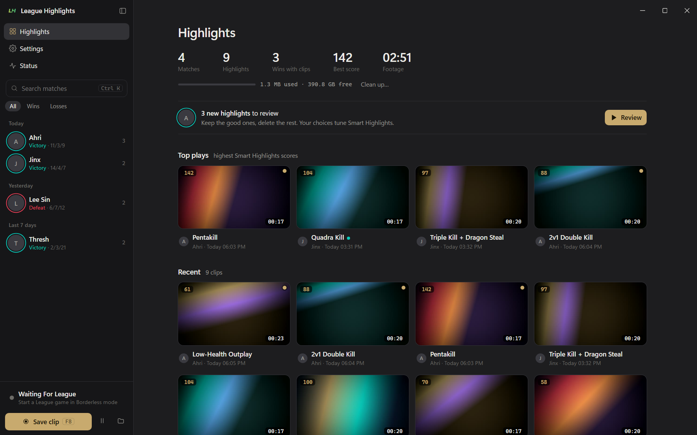
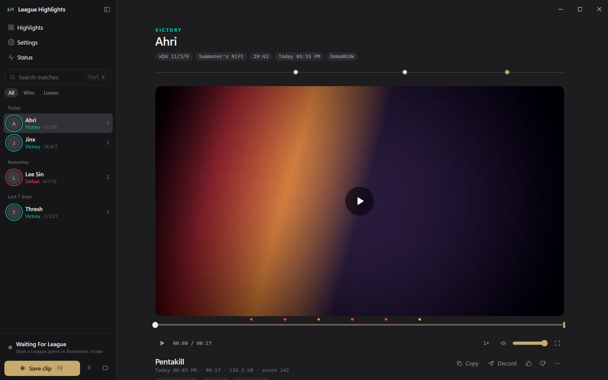
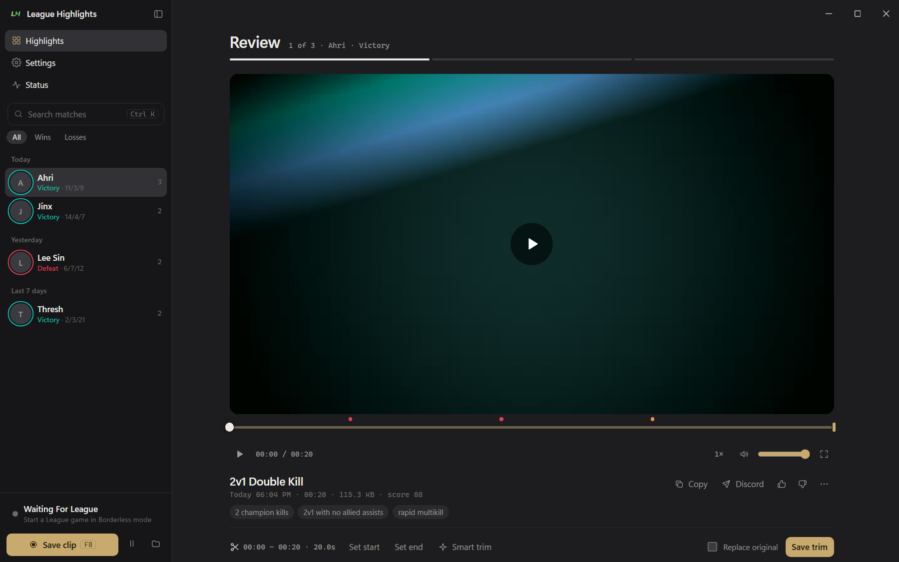
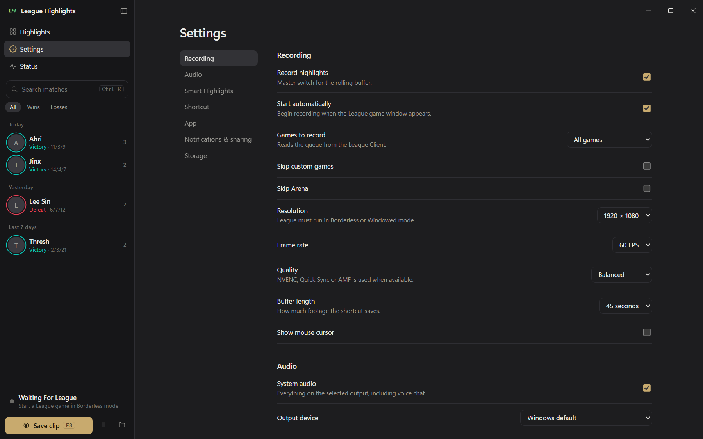

# League Highlights

A lightweight, privacy-first League of Legends highlight recorder for Windows.
It keeps a rolling buffer while a match runs, saves clips on a global
shortcut, and lets Smart Highlights keep kills, multikills, outnumbered plays,
support impact, low-health survivals and objective steals automatically.

Version 2 is a rewrite in Rust: one ~2 MB executable plus `ffmpeg.exe`, with no
Python runtime and no Qt. **[Download the latest release](https://github.com/Kirbyy1/League-Highlights/releases/latest)**



## Screenshots

| Match page and player | Post-match review |
|---|---|
|  |  |



<sub>Screenshots use a demo library with placeholder footage.</sub>

## Features

- **Lightweight recording**: FFmpeg Desktop Duplication with NVENC, Quick Sync
  or AMF (zero-copy on NVIDIA at native resolution), WASAPI system and
  microphone audio, and low-priority capture with a disk-space guard.
- **Smart Highlights V2**: fight grouping, adaptive pre/post-roll, duplicate
  suppression and explainable scores. It also keeps shutdowns, first blood,
  epic-monster steals and the winning moment, limits routine clips per match,
  and learns from your ratings.
- **In-game toast**: a small click-through notice over the game when a clip
  is saved (or fails).
- **Post-match review**: when a game ends, step through its new clips and keep,
  rate or delete each with one key.
- **Library**: match-grouped highlights with champion art, a custom player
  with event markers, lossless trim and Smart Trim, and multi-select.
- **Editor**: trim a clip, add background music from your own files, balance
  game and music volume with fades, and save a new clip without re-encoding
  the video.
- **Sharing**: copy a clip to the clipboard (paste into Discord), or make a
  Discord-ready copy that fits your upload limit.
- **Storage**: usage and free space at a glance, plus optional automatic
  clean-up (clips rated Good are never removed).
- **Setup check**: verifies FFmpeg, encoder, capture, League's window mode,
  audio, clip folder and disk space, with one-click fixes.

## Footprint

Measured on the release build:

| | |
|---|---|
| Idle in the tray | ~0 CPU, ~2.5–4.5 MB private memory |
| Polling a live match (not recording) | ~0.4 % of one core |
| Library window open | 5 processes, ~140 MB private (released when closed or minimized) |
| Recording 1080p60 on NVENC | FFmpeg ≈ 0.5 % CPU (frames stay on the GPU) |
| Saving a clip | 1 FFmpeg run, ~1.7 s for a 10 s clip |

## Install

Run `LeagueHighlightsSetup-<version>.exe`. It installs for the current user
(no administrator prompt) to `%LOCALAPPDATA%\Programs\League Highlights`, adds
a Start-menu entry and optionally starts with Windows. Uninstalling keeps your
clips and settings.

The portable zip works too: unzip anywhere and run `LeagueHighlights.exe`.

Requirements: Windows 10 1809+ or 11 (64-bit), League in **Borderless** or
Windowed mode. The library window uses the WebView2 runtime that ships with
Windows 11 (on Windows 10 without it, the library opens in your browser).

## Build

```powershell
cargo build --release --locked
.\scripts\download_ffmpeg.ps1        # ffmpeg.exe next to target\release\LeagueHighlights.exe
cargo test --release
```

### Release

```powershell
.\scripts\package.ps1                # zip + installer + SHA256SUMS in dist\
.\scripts\package.ps1 -Ffmpeg C:\path\to\ffmpeg.exe
```

The package bundles `target\release\ffmpeg.exe` and downloads the FFmpeg
"essentials" build there if it is missing. FFmpeg is almost all of the
download, and the essentials build has everything the app uses at about half
the size of the "full" build, so the copy on your `PATH` is not used.

Needs [Inno Setup 6](https://jrsoftware.org/isinfo.php) for the installer
(`winget install JRSoftware.InnoSetup`); `-NoInstaller` builds only the zip.
Tag releases `v2.x.y`: the in-app update check compares against the latest
GitHub release, so the older Python `v1.x` releases are never offered.

## Run

- `LeagueHighlights.exe` starts in the tray and opens the library window.
- `--startup` starts quietly (used by Start with Windows).
- `--selftest` records the primary monitor for 8 seconds and saves one clip;
  `--selftest --synthetic` uses a CPU test pattern instead.
- `LH_DATA_DIR` points the app at a portable or sandboxed data folder.

## Network use

Gameplay never leaves the PC. The app contacts only:

- Riot's local Live Client and League Client APIs on `127.0.0.1` during games;
- Riot's Data Dragon CDN for champion icons and splash art, once per champion
  (Settings → App → Champion art);
- GitHub's releases API every few hours to show an update link
  (Settings → App → Check for updates).

## Files

| What | Where |
|---|---|
| Clips | `%USERPROFILE%\Videos\League Highlights` (configurable) |
| Discord copies | `<clip folder>\Shared` |
| Settings | `%LOCALAPPDATA%\LeagueHighlights\settings.json` |
| Log | `%LOCALAPPDATA%\LeagueHighlights\logs\league_highlights.log` |

Settings, clips and clip metadata are compatible with the Python version.

## Layout

```
src/main.rs        startup, threads, single instance
src/controller.rs  game-window state machine, recovery, export worker
src/recorder.rs    FFmpeg rolling segment capture and timing
src/audio.rs       WASAPI loopback / microphone ring buffers
src/live.rs        Live Client polling, Smart Highlights V2
src/scoring.rs     scoring, ratings feedback, Smart Trim
src/lcu.rs         queue filter via the League Client
src/exporter.rs    segments to clip (single FFmpeg run)
src/library.rs     metadata, review flag, storage, clean-up, trim
src/share.rs       Discord-sized copies
src/setup.rs       first-run setup check
src/update.rs      GitHub release check
src/web.rs         localhost UI server (token, host and CSRF checks)
src/window.rs      WebView2 window with custom title bar
src/overlay.rs     in-game toast
src/tray.rs        notification-area icon and menu
src/hotkey.rs      low-level keyboard hook
ui/index.html      library, player, review, settings
installer/         Inno Setup script
scripts/           FFmpeg download and release packaging
```

## Licences and notices

`ffmpeg.exe` is FFmpeg, licensed under the GPL or LGPL depending on the
build; `scripts\package.ps1` records the bundled build in
`THIRD-PARTY-NOTICES.txt`.

League Highlights isn't endorsed by Riot Games and doesn't reflect the views or
opinions of Riot Games or anyone officially involved in producing or managing
Riot Games properties. Riot Games, and all associated properties are
trademarks or registered trademarks of Riot Games, Inc.
